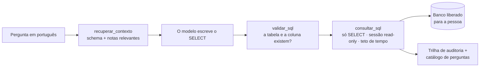

# motor-consulta

**Um motor para a IA consultar bancos de dados de produção sem inventar coluna, sem
esquecer o que já descobriu e sem conseguir escrever uma linha sequer.**

> Este repositório acompanha o artigo
> **[Quanto mais desestruturado o seu dado, maior o seu ganho](https://substack.com/home/post/p-213281631)** no Substack,
> onde conto como o projeto nasceu e o que aprendi construindo. Aqui está o código —
> e um banco de exemplo para você ver tudo funcionando em dois minutos.

---

## O problema

Pedir a um modelo de linguagem "quanto faturamos no trimestre?" e deixá-lo escrever o
SQL parece resolvido — até você tentar contra um banco de verdade. Três coisas dão
errado, sempre nesta ordem:

1. **Ele inventa.** Nome de tabela que não existe, coluna que "deveria" existir. O
   schema de um ERP real não cabe no prompt, então o modelo preenche o que falta com
   o que é plausível.
2. **Ele erra o critério, não a sintaxe.** O SQL roda, devolve um número, e o
   número está errado: entrou pedido cancelado, usou o preço de cadastro em vez do
   preço da venda, esqueceu o desconto. Essas regras não estão no schema — estão na
   cabeça de quem já apanhou daquele banco.
3. **Ele esquece.** A armadilha descoberta hoje vai ser redescoberta (ou não) na
   semana que vem, por outra pessoa, em outra conversa.

E por cima disso tudo: é **banco de produção**. Um `DELETE` gerado por engano, uma
consulta que trava o servidor, uma credencial que vaza — nada disso é aceitável.

## A ideia

O agente não está aqui dentro. Quem pensa é o modelo do cliente (Claude Code, Claude
Desktop ou qualquer cliente [MCP](https://modelcontextprotocol.io)). O que este
projeto entrega são as duas camadas que fazem esse agente ser **útil sem ser
perigoso**:

- **Memória** — uma base de conhecimento versionada no git: um dicionário de dados
  gerado do catálogo do banco + **notas curtas** com as regras e armadilhas que só a
  experiência ensina. A cada pergunta, o modelo recebe só o pedaço relevante.
- **Contenção** — só `SELECT`/`WITH` passam; a sessão do banco é read-only; toda
  consulta tem teto de tempo; tabela e coluna são conferidas antes de executar; cada
  pessoa só alcança os bancos liberados para ela; e tudo fica registrado.



Funciona com **PostgreSQL, MySQL/MariaDB, SQL Server, Oracle, Firebird e SQLite**.

## Uma pergunta, quatro respostas

O repositório traz um banco de exemplo: uma loja fictícia de papelaria e informática,
com um ano de pedidos. Pergunte "quanto a loja faturou em 2025?" e veja quantos
números plausíveis existem:

| O SQL que parece certo | Resultado |
|---|---|
| soma de todos os itens de pedido | R$ 2.590.770,23 — inclui cancelados e abertos |
| quantidade × preço do produto | R$ 2.588.460,94 — usa o preço de **hoje**, já reajustado |
| quantidade × preço da venda | R$ 2.414.739,00 — esquece o desconto |
| **pedidos faturados, preço da venda, com desconto** | **R$ 2.317.595,29** ✔ |

E "receita líquida" é outra conta ainda: a view mensal do banco **não** abate
devoluções (R$ 2.259.076,92).

Nenhum desses erros é de sintaxe, e nenhum aparece no schema. Eles estão nas notas de
[`NOTES/loja/`](NOTES/loja/) — e é por isso que o modelo acerta quando as recebe.

## Experimente em 2 minutos

Só Python 3.10+, sem instalar nenhum pacote:

```bash
git clone https://github.com/gaiekdacosta/motor-consulta.git
cd motor-consulta
cp .env.example .env
python3 exemplo/criar_banco.py          # gera o banco de exemplo (SQLite)

python3 consultar.py query "SELECT * FROM vw_faturamento_mensal LIMIT 3"
python3 recuperar.py "quanto a loja faturou por categoria em 2025"
python3 validar_sql.py "SELECT p.preco_venda FROM produtos p"
```

- O `recuperar.py` mostra exatamente o que o modelo receberia antes de escrever o
  SQL: o schema das tabelas certas e as notas que avisam das armadilhas.
- O `validar_sql.py` aponta a coluna inventada e sugere a que existe
  (`talvez: PRECO_TABELA`).
- O `consultar.py` recusa qualquer coisa que não seja leitura — experimente um
  `DELETE`.

Para conversar com o banco pelo **Claude Code**:

```bash
pip install -r requirements.txt
claude mcp add motor-consulta -- python3 "$PWD/mcp_server.py"
```

## Ligando o seu banco

Cada banco é um **perfil** no `.env`:

```ini
PERFIS=vendas,rh
PERFIS_SENSIVEIS=rh                 # dado de pessoa: o modelo é orientado a agregar
db_vendas_engine=postgres
db_vendas_host=10.0.0.10
db_vendas_database=erp
db_vendas_username=leitura          # use SEMPRE um usuário que só pode ler
db_vendas_password=...
db_vendas_descricao=ERP — pedidos, notas fiscais e estoque
```

Depois:

```bash
python3 consultar.py --perfil vendas ping
python3 gerar_dicionario.py --perfil vendas --todas   # banco pequeno: catálogo inteiro
python3 gerar_dicionario.py --perfil vendas           # banco grande: só o que as notas usam
```

E, a cada descoberta, **uma nota** em `NOTES/<banco>/<assunto>/`, partindo do
[modelo](NOTES/_TEMPLATE.md). O [.env.example](.env.example) traz a configuração de
cada engine.

## Para a equipe inteira

O mesmo conhecimento servido a várias pessoas: um servidor MCP, um proxy Caddy que
exige **token individual** e um **painel web** para criar, renovar e revogar acessos e
escolher os bancos de cada pessoa.

```bash
cp .env.example .env && cp .env.admin.example .env.admin
cp caddy/tokens.caddy.example caddy/tokens.caddy
docker compose up -d mcp proxy admin
```

O painel entrega o comando pronto para o Claude Code e a configuração do Claude
Desktop. Passo a passo em [docs/IMPLANTACAO.md](docs/IMPLANTACAO.md).

## O que aprendi construindo

Cada item abaixo é uma decisão de código que nasceu de algo que deu errado — ou que
quase deu.

**1. O dicionário inteiro não cabe — e não deveria caber.** O schema de um ERP real
passa de centenas de milhares de tokens. A recuperação (índice TF-IDF + grafo de
tabelas) entrega alguns milhares por pergunta: as tabelas certas, as tabelas-ponte e
as notas ligadas. Sem API de embedding, sem banco vetorial — Python puro e um JSON
versionado no git.

**2. Radical não é sinônimo.** O índice trata plural e flexão do português
(`devoluções` → `devolucao`) e casa abreviação com palavra inteira (`fatur` ~
`faturamento`). Mas nenhuma regra liga `devolução` a `estorno`. Para isso existe um
glossário escrito à mão — aplicado só à pergunta, para não exigir reconstruir o
índice.

**3. Validar antes de executar muda o comportamento do modelo.** Quando a coluna
inventada volta como erro com sugestão (`talvez: PRECO_TABELA`), o modelo corrige e
segue. Quando volta como erro genérico do banco, ele tenta outro caminho — às vezes
pior.

**4. Read-only é uma pilha, não uma linha.** O validador recusa tudo que não seja
`SELECT`/`WITH` (inclusive `WITH ... DELETE`). Por baixo, a sessão do banco também é
read-only: nos testes, nem a conta **dona** do banco consegue apagar uma linha. E por
baixo de tudo, o conselho que nenhum código substitui: dê à ferramenta um usuário que
só pode ler.

**5. Header que diz "quem pode o quê" só vale se ninguém puder forjá-lo.** O proxy
injeta, por pessoa, os bancos liberados. Mas quem alcançasse a porta do servidor MCP
**direto** mandaria esse header por conta própria e consultaria tudo, sem token. A
correção é um segredo que só o proxy conhece, conferido no transporte — antes de
qualquer tool, resource ou prompt.

**6. Configuração que não chegou nunca vira permissão.** Segredo vazio: o servidor
recusa tudo. Lista de bancos vazia: ninguém consulta nada. Painel sem senha: só sobe
em `127.0.0.1`. Em todo lugar onde faltar config, o padrão é negar.

**7. Uma consulta travada não pode derrubar todo mundo.** Uma ferramenta síncrona
rodando no event loop fazia uma única consulta pendurada parar o servidor para todos
os usuários. Hoje a consulta roda numa thread **e** um vigia a cancela quando passa do
teto de tempo — as duas metades são necessárias.

**8. Sessão longa em rede real morre de um jeito feio.** Um stream aberto por horas é
cortado em silêncio por um firewall; a reconexão do cliente leva um erro e a
ferramenta some até o app reiniciar. Como as tools são síncronas e o servidor nunca
empurra nada, a solução foi abrir mão da sessão.

**9. "Achou alguma coisa" é sempre verdade.** Para descobrir que perguntas a base não
sabe responder, o natural seria marcar "não recuperou nada". Mas a similaridade de
cosseno sempre devolve *alguma* nota. O que funciona é guardar a **força** da melhor
nota: abaixo de um piso, a pergunta entra numa fila de lacunas, e um relatório semanal
transforma cada lacuna num rascunho de nota, com as consultas que funcionaram.

**10. Token sem prazo é vazamento sem prazo.** Todo acesso vence. Renovar estende o
prazo sem trocar o token (ninguém reconfigura máquina); rotacionar troca o token. E a
trilha de auditoria guarda cada consulta — inclusive as recusadas, que são as mais
interessantes.

## Segurança em uma tabela

| Camada | O que garante |
|---|---|
| validador | uma instrução só, começando por `SELECT`/`WITH`, sem comando de escrita no meio |
| sessão do banco | read-only no PostgreSQL, MySQL/MariaDB e SQLite |
| teto de tempo | no servidor (PostgreSQL, MySQL) ou por cancelamento (Oracle, Firebird, SQLite) |
| proxy | token por pessoa; injeta bancos liberados, identidade e validade |
| segredo do proxy | o servidor MCP recusa qualquer requisição que não passou pelo proxy |
| painel | não recebe as senhas dos bancos; sem senha, só em loopback |
| trilha | toda consulta e toda recusa, com pessoa, banco e SQL |

## O que ele não é

- **Não é um BI.** Ele responde perguntas e cita a consulta que usou; não monta
  painel nem guarda resultado.
- **Não substitui conhecer o banco.** As notas são escritas por gente que conferiu o
  dado. O relatório de lacunas aponta onde escrever; o julgamento é humano.
- **O guardrail libera na dúvida.** Ele existe para o modelo se corrigir, não como
  trava de segurança — essa é o validador de leitura e a sessão read-only.
- **A busca é léxica e em português.** TF-IDF com regras de flexão do português, sem
  embeddings. Trocar por embeddings mexe em uma etapa só (`vetorial.buscar`).

## Mapa do repositório

| Arquivo | Papel |
|---|---|
| [perfis.py](perfis.py) · [conexao.py](conexao.py) | perfis do `.env` e conexão read-only nos 6 engines |
| [consultar.py](consultar.py) | CLI e o único caminho de execução de SQL |
| [validar_sql.py](validar_sql.py) | guardrail de schema |
| [gerar_dicionario.py](gerar_dicionario.py) | catálogo do banco → dicionário em markdown |
| [vetorial.py](vetorial.py) · [grafo.py](grafo.py) · [recuperar.py](recuperar.py) | índice, grafo das notas e recuperação |
| [mcp_server.py](mcp_server.py) | servidor MCP |
| [admin_app.py](admin_app.py) · [admin_tokens.py](admin_tokens.py) | painel de acessos |
| [auditoria.py](auditoria.py) · [perguntas.py](perguntas.py) | trilha de consultas e fila de lacunas |
| [check.py](check.py) · [tests/](tests/) | verificador da base e testes (rodam no CI) |

O porquê de cada decisão, em detalhe: [ARQUITETURA.md](ARQUITETURA.md).
